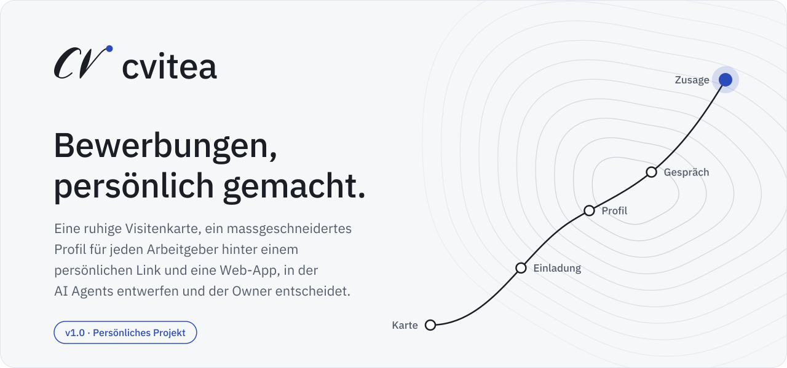
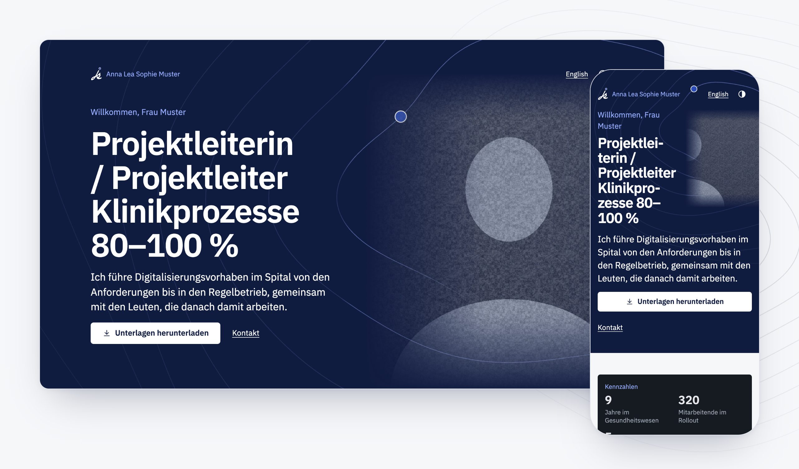
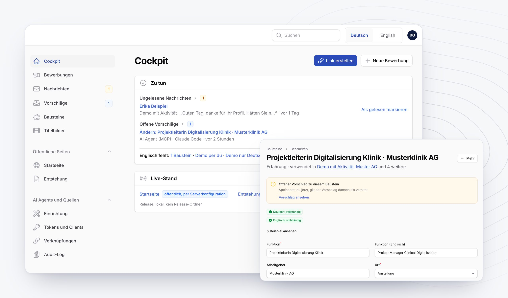
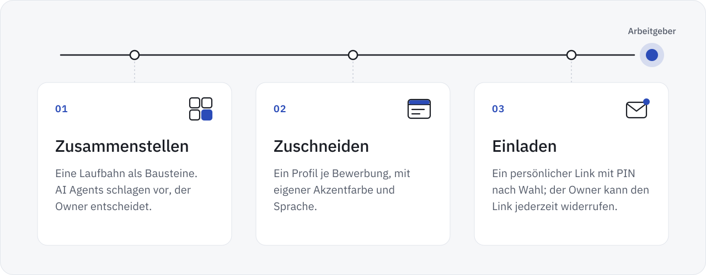
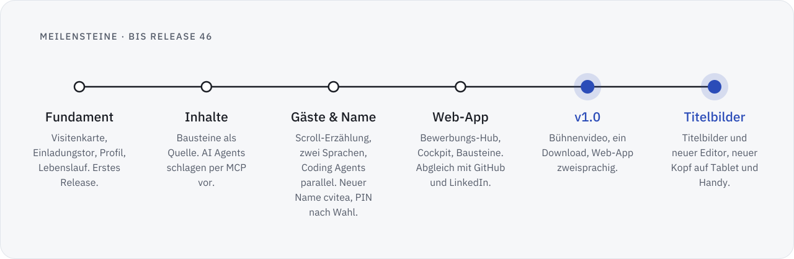

<picture>
  <source media="(prefers-color-scheme: dark)" srcset="assets/hero.de.dark.svg">
  
</picture>

[English](README.md) · **Deutsch**

cvitea ist ein persönliches Projekt und eine Arbeitsprobe in Agentic Engineering. Die Bewerbungsplattform ergänzt die üblichen Unterlagen um eine ruhige, private Website:

- eine öffentliche Visitenkarte,
- ein massgeschneidertes Profil für jeden Arbeitgeber, hinter einem persönlichen Einladungslink,
- eine Web-App, in der AI Agents entwerfen und der Owner entscheidet, was erscheint.

Version 1.0 und die Releases seither laufen produktiv. Dieses Repository zeigt, wie es funktioniert, wie es entsteht und was als Nächstes kommt. Der Quellcode ist privat.

## In Bildern

<picture>
  <source media="(prefers-color-scheme: dark)" srcset="assets/screens/guest.de.dark.jpg">
  
</picture>

Was ein Arbeitgeber sieht: der Kopf des Profils einer Bewerbung am Desktop und am Telefon, wo Titelbild und Titel eine Zeile teilen.

<picture>
  <source media="(prefers-color-scheme: dark)" srcset="assets/screens/owner.de.dark.jpg">
  
</picture>

Womit der Owner arbeitet: das Cockpit mit den Aufgaben des Tages und der Editor eines Bausteins mit seiner Vollständigkeit je Sprache.

Alle Bilder zeigen erfundene Demo-Daten in einer neutralen Akzentfarbe.

## So funktioniert cvitea

<picture>
  <source media="(prefers-color-scheme: dark)" srcset="assets/how-it-works.de.dark.svg">
  
</picture>

1. **Zusammenstellen.** Eine Laufbahn besteht aus Bausteinen: Stellen, Projekte, Ausbildung, Fähigkeiten, Dokumente und Texte. AI Agents, angebunden über das Model Context Protocol (MCP), schlagen neue Bausteine, Änderungen, Anpassungen einer Bewerbung und Übersetzungen vor. Erscheinen kann nichts, bevor der Owner es annimmt.
2. **Zuschneiden.** Jede Bewerbung bekommt ihr eigenes Profil: die Bausteine, die für diese Stelle zählen, in der passenden Reihenfolge, mit eigener Akzentfarbe, auf Deutsch oder Englisch. Ein Titelbild aus der Bibliothek des Owners, ein Video oder ein Bild, eröffnet das Profil; wo es steht und wie gross es ist, legt der Owner je Gerät in einem Editor fest, der den Bildschirm des Gastes zeigt. Eine Vorschau zeigt genau, was der Arbeitgeber sehen wird.
3. **Einladen.** Ein persönlicher Link öffnet das Profil, eine PIN nach Wahl schützt es zusätzlich. Aufrufe werden erfasst, wie es der Datenschutzhinweis auf der Einladungsseite beschreibt: Zeit, Seite, Gerätetyp, Browser und ungefährer Ort, ohne IP-Adresse; Einträge werden nach höchstens 180 Tagen gelöscht, und der Owner kann den Link jederzeit widerrufen. Was hinter einem Link liegt, nehmen Suchmaschinen nicht auf.

## Grundsätze

- **Privat als Standard.** Einladungslinks tragen rund 60 Bit Zufall; das Einladungstor prüft sie nur gegen einen Schlüssel-Hash, sonst sind sie nur verschlüsselt gespeichert; sie sind gedrosselt und widerrufbar. Die Plattform hält Personendaten in ihrer Datenbank und ihrem Speicher auf Schweizer Webhosting; dieses öffentliche Repository enthält keine.
- **AI Agents entwerfen, Menschen entscheiden.** Sie arbeiten mit Tokens mit festen Berechtigungen und Limits: Ein AI Agent erreicht nur, was seine Berechtigungsbereiche erlauben, ein persönliches Token lässt sich auf ein Thema wie Übersetzungen beschränken, und jede Änderung ist ein Vorschlag oder ein privater Upload. AI Agents schlagen Inhalte und Dokumente vor; live geht nichts ohne die Freigabe des Owners.
- **Nur rechtmässige Quellen.** Kein Scraping von Jobportalen. Daten kommen aus den eigenen Exporten der Person und aus offiziellen Schnittstellen.
- **Ruhig und schnell.** Zwei Sprachen für Gäste und in der Web-App, für Gäste dunkel als Standard und hell auf Wunsch, vom 375-px-Telefon bis zum Desktop. Bewegung gibt es nur, wo die Systemeinstellung sie erlaubt, und das Zeichen schreibt sich mit langsamem Anfang und langsamem Ende. Der Prüfweg testet mit axe bei 375 und 1280 px und mit Lighthouse.

## Stand

<picture>
  <source media="(prefers-color-scheme: dark)" srcset="assets/timeline.de.dark.svg">
  
</picture>

Vom ersten Commit bis Version 1.0 und darüber hinaus.

Die Meilensteine als Text

| Schwerpunkt | Was dazukam |
|---|---|
| Fundament | Öffentliche Visitenkarte, Einladungstor, Profil und Online-Lebenslauf, Owner-Login mit zweitem Faktor als Pflicht, Deploy-Skript mit Probelauf. Das erste Release geht live. |
| Inhalte und AI Agents | Bausteine werden die einzige Quelle der Inhalte. Ein MCP-Server lässt AI Agents Änderungen vorschlagen, mit Abnahmetests und Protokoll abgewiesener Werkzeugaufrufe. |
| Gäste und Name | Coding Agents bauen ab jetzt parallel, eine koordinierende Session verteilt die Aufgaben. Eine Scroll-Erzählung im Profil, ein Lebenslauf zum Überfliegen, zweisprachige Inhalte. Die Plattform heisst jetzt cvitea, mit einer PIN je Einladung nach Wahl, schlankeren Deploys und UI-Audits von Gästeseiten und Verwaltung. |
| Web-App und Anbindungen | Bewerbungs-Hub, Cockpit mit Aufgaben zuerst, überarbeitete Bausteine, Limits für Agent-Tokens, Markenauftritt. Eine Akzentfarbe je Bewerbung, Abgleich mit GitHub in beide Richtungen, LinkedIn-Import mit geführtem Vergleich. Das Zeichen schreibt sich als Intro. |
| **v1.0** | Ein Bühnenvideo im Kopf einer Bewerbung: aus einer Bibliothek gewählt, mit Überblendungen aus einem Editor und transparentem Video. Ein Download für alle Dokumente als zusammengeführtes PDF. Die Web-App auf Deutsch und Englisch, wählbar je Nutzer. Bilder und Videos, die als KI-generiert markiert sind, tragen einen sichtbaren Hinweis. Bewegung, die dem Scrollen folgt. |
| Titelbilder | Aus den Bühnenvideos werden Titelbilder: eine Bibliothek aus Videos und Bildern für den Kopf einer Seite, mit Lage und Grösse je Geräteklasse (Handy, Tablet, Desktop). Der Editor zeigt den Bildschirm des Gastes und den Kopf auf Englisch. Danach wird er zur Werkstatt: Werkzeuge für Position, Zuschnitt und Blenden, eine Vorher-Ansicht, alle Geräte auf einen Blick, Zoom und Tastenkürzel. Den Ton für Gäste wählt der Owner: stumm starten, Start per Klick mit Ton oder kein Ton. |
| Kopf und Bewegung | Auf dem Tablet übernimmt der Kopf das Band des Desktops, mit dem Text links und dem Titelbild am Rand; am Handy teilen Titelbild und Titel eine Titelzeile, und die Höhenlinien laufen gedämpft hinter dem Text weiter. Ein ruhigeres Logo-Intro mit langsamem Anfang und Ende. Für Gäste ist Dunkel der Standard, und beim Neuladen springt die Seite nicht mehr nach unten. Die Knöpfe des Titelbilds bleiben an einem festen Ort, mit Trefferflächen von 44 px. |
| Links und AI Agents | Je Einladungslink können die deutschen Gästeseiten per du ansprechen, Standard bleibt Sie. Einladungscodes mit 12 Zeichen ohne verwechselbare Zeichen, nachsichtig beim Eintippen. AI Agents bekommen einen kurzlebigen Vorschau-Link der Gästeansicht. Eine Fallstudie kann ihre Quelle verlinken, mit dem GitHub-Zeichen. Schärfere Standbilder für Titelvideos. |
| Korrekturen | In Safari springt die Seite beim Neuladen nicht mehr zum Kontaktformular, und Inhalte, die sich an ihren Platz heben, verschieben die Seite nicht mehr. In der Verwaltung läuft das Änderungsprotokoll nicht mehr seitwärts, und die Seiten eines Titelbilds haben Abstand zueinander. |

**Was es heute kann** (Stand Oktober 2026)

- Öffentliche Visitenkarte und ein privates Profil je Bewerbung, auf Deutsch und Englisch, für Gäste dunkel als Standard und hell auf Wunsch
- Online-Lebenslauf und Dokumente mit einem Download für alle, eine Akzentfarbe je Bewerbung und eine PIN nach Wahl je Einladungslink
- Titelbilder im Kopf einer Seite: Videos oder Bilder für eine Bewerbung, Videos für die Visitenkarte, mit Überblendungen und transparentem Video, einer Lage je Gerät und dem Ton für Gäste nach Wahl des Owners
- Ein Editor für das Titelbild, der den Bildschirm des Gastes auf Handy, Tablet und Desktop zeigt, mit Werkzeugen für Position, Zuschnitt und Blenden, einer Vorher-Ansicht und Tastenkürzeln
- Einladungscodes mit 12 Zeichen ohne verwechselbare Zeichen wie 0 und O; Gross- und Kleinschreibung, Leerzeichen und Bindestriche spielen beim Eintippen keine Rolle
- Deutsche Gästeseiten per Sie oder, je Einladungslink wählbar, per du
- Web-App für den Owner auf Deutsch und Englisch: Bewerbungs-Hub, Cockpit, Bausteine, Vorschläge, Übersetzungen, Medien und Titelbilder
- AI Agents über MCP: 11 Werkzeuge, 9 Berechtigungsbereiche, Limits für Tempo und Umfang; jede Änderung ist ein Vorschlag oder ein privater Upload; ein Vorschau-Link von höchstens zehn Minuten zeigt einem AI Agent die Gästeansicht, ohne als Aufruf zu zählen; als KI-generiert markierte Medien tragen einen sichtbaren Hinweis
- GitHub und LinkedIn: Import, Vergleich und Vorschläge in beide Richtungen; eine Fallstudie kann ihre Quelle auf GitHub verlinken
- Laravel 13 und Filament 5 auf Schweizer Webhosting (PHP 8.5, MariaDB 10.11)

## Roadmap

<picture>
  <source media="(prefers-color-scheme: dark)" srcset="assets/roadmap.de.dark.svg">
  
</picture>

Jeder Schritt baut auf den Daten des vorigen auf.

Reihenfolge, Gründe und offene Ideen: [ROADMAP.de.md](ROADMAP.de.md)

## So entsteht cvitea

Eine Person steuert cvitea und baut es mit Coding Agents. Der Owner setzt die Ziele und die Regeln und entscheidet über jedes Release und jeden Push; eine koordinierende Agent-Session teilt die Arbeit in Aufgaben, gibt deren Pläne nach Regeln des Owners frei, nimmt ihre Ergebnisse ab und führt sie zusammen, Aufgaben-Sessions bauen parallel in eigenen Worktrees. Jedes Release braucht die Freigabe des Owners, und das Deploy-Skript bricht ab, wenn `composer ci` rot ist.

<picture>
  <source media="(prefers-color-scheme: dark)" srcset="assets/quality.de.dark.svg">
  
</picture>

Rollen, Regeln und Prüfweg: [So entsteht cvitea](docs/how-its-built.de.md)

## Zu diesem Repository

Dieses Repository enthält nur Dokumentation und Grafiken; der Quellcode der Plattform ist privat. Alle Inhalte © 2026, alle Rechte vorbehalten: siehe [LICENSE](LICENSE). Wie Sicherheitslücken gemeldet werden, steht in [SECURITY.md](SECURITY.md).

 
<picture>
  <source media="(prefers-color-scheme: dark)" srcset="assets/logo-mark.dark.svg">
  
</picture>

