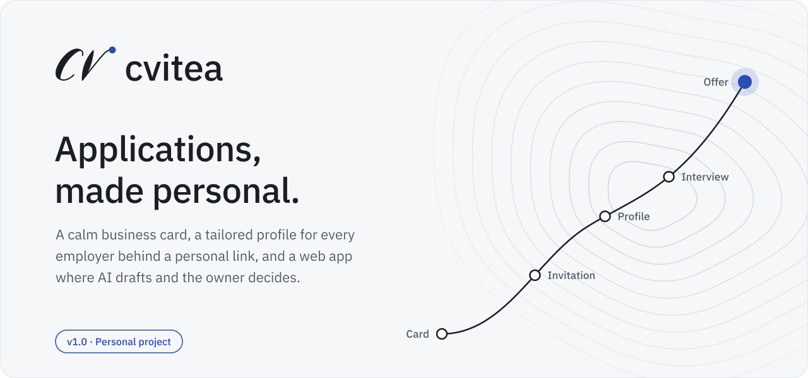
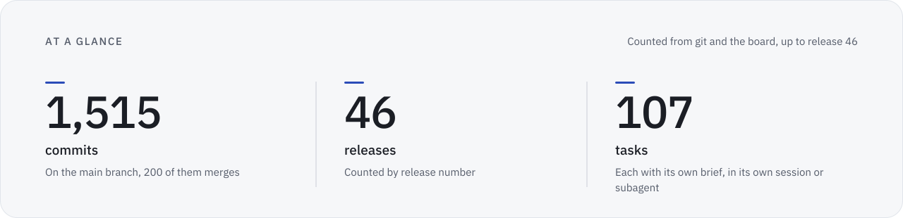
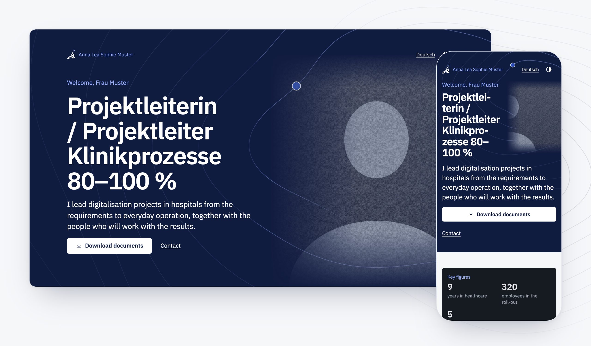
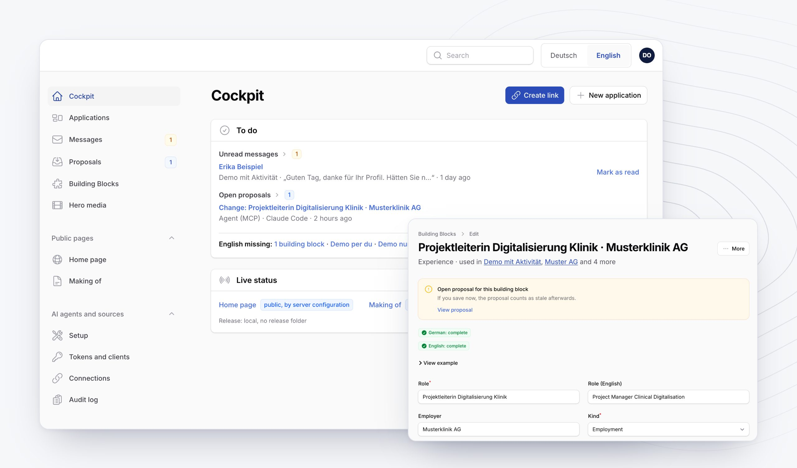
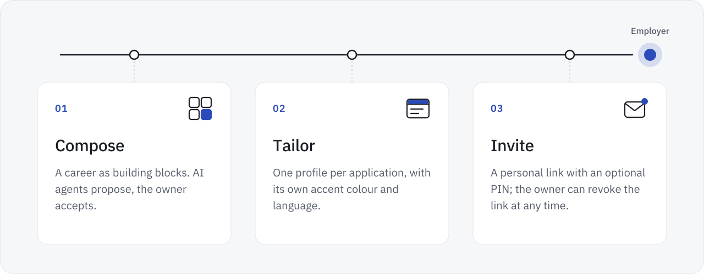
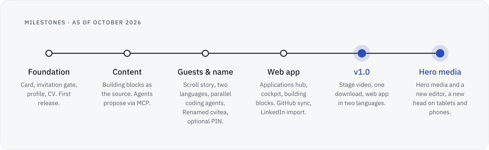
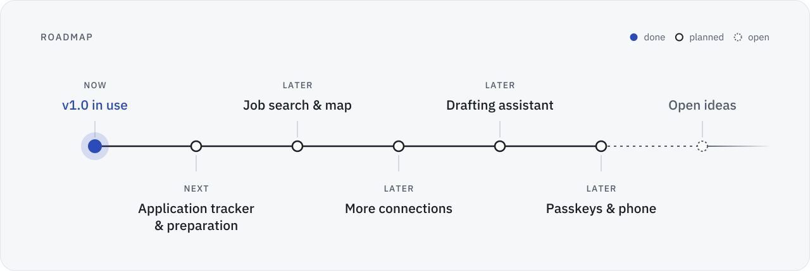

<picture>
  <source media="(prefers-color-scheme: dark)" srcset="assets/hero.en.dark.svg">
  
</picture>

**English** · [Deutsch](README.de.md)

cvitea is a personal project and a work sample in agentic engineering. The application platform adds a calm, private website to the usual documents:

- a public business card,
- a tailored profile for every employer, behind a personal invitation link,
- a web app in which AI agents draft and the owner decides what is published.

Version 1.0 and the releases since run in production for the person who built them. This repository shows how it works, how it is built and what comes next. The source code is private.

<picture>
  <source media="(prefers-color-scheme: dark)" srcset="assets/at-a-glance.en.dark.svg">
  
</picture>

Method and sources: [By the numbers](docs/how-its-built.md#by-the-numbers).

## In pictures

<picture>
  <source media="(prefers-color-scheme: dark)" srcset="assets/screens/guest.en.dark.jpg">
  
</picture>

What an employer sees: the head of an application's profile on a desktop and on a phone, where the hero and the title share one row.

<picture>
  <source media="(prefers-color-scheme: dark)" srcset="assets/screens/owner.en.dark.jpg">
  
</picture>

What the owner works with: the cockpit with today's tasks, and the editor of a building block with its completeness per language.

All pictures show fictional demo data in a neutral accent colour.

## How it works

<picture>
  <source media="(prefers-color-scheme: dark)" srcset="assets/how-it-works.en.dark.svg">
  
</picture>

1. **Compose.** A career lives in building blocks: roles, projects, education, skills, documents and texts. AI agents connected over the Model Context Protocol (MCP) propose new blocks, edits, changes to an application and translations. Nothing is published until the owner accepts it.
2. **Tailor.** Every application gets its own profile: the blocks that matter for this role, in the right order, with its own accent colour, in German or English. A hero from the owner's library, a video or an image, opens the profile; where it stands and how large it is, the owner sets per device in an editor that shows the guest's screen. A preview shows exactly what the employer will see.
3. **Invite.** A personal link opens the profile, and an optional PIN guards it. Visits are recorded as the privacy notice on the invitation page describes: time, page, device type, browser and approximate location, without the IP address; entries are deleted after at most 180 days, and the owner can revoke the link at any time. Search engines index nothing behind a link.

## Principles

- **Private by default.** Invitation links carry about 60 bits of randomness; the gate checks them against keyed hashes only and otherwise keeps them encrypted, and they are rate-limited and revocable. The platform keeps personal data in its database and storage on Swiss web hosting; this public repository contains none.
- **AI drafts, people decide.** Agents work with scoped tokens and hard limits: an agent reaches only what its scopes allow, a personal token can be limited to one area, and every write is a proposal or a private upload. Agents propose content and documents; nothing goes live without the owner's approval.
- **Legal sources only.** No scraping of job portals. Data comes from the person's own exports and from official APIs.
- **Calm and fast.** Two languages for guests and in the web app, dark by default for guests and light on request, from 375 px phones to desktop. Motion respects reduced-motion settings, and the logo writes itself with a slow start and a slow end. The check path tests with axe at 375 and 1280 px and with Lighthouse.

## Where it stands

<picture>
  <source media="(prefers-color-scheme: dark)" srcset="assets/timeline.en.dark.svg">
  
</picture>

From the first commit to version 1.0, and on to release 46.

The milestones as text

| Focus | What landed |
|---|---|
| Foundation | Public card, invitation gate, profile and online CV, owner login with mandatory two-factor authentication, deploy script with dry run. The first release goes live. |
| Content and agents | Building blocks become the single source of content. An MCP server lets AI agents propose changes, with acceptance tests and an audit of refused tool calls. |
| Guests and name | Coding agents start building in parallel; a coordinating session hands out the tasks. A scroll story on the profile, a CV made for skimming, bilingual content. The platform becomes cvitea, with an optional PIN per invitation, leaner deploys and UI audits of the guest pages and the admin. |
| Web app and integrations | Applications hub, task-first cockpit, reworked building blocks, limits for agent tokens, brand assets. An accent colour per application, GitHub sync in both directions, LinkedIn import with a guided comparison. The mark writes itself as an intro. |
| **v1.0** | A stage video in the head of an application: chosen from a library, with fades set in an editor and transparent video. One download for all documents as a merged PDF. The web app in German and English, chosen per user. Pictures and videos marked as AI-generated carry a visible note. Motion that follows the scroll. |
| Hero media | The stage videos become hero media: a library of videos and images for the head of a page, with position and size per device class (phone, tablet, desktop). The editor shows the guest's screen and the head in English. Then it becomes a workshop: tools for position, crop and fades, a before view, all devices at a glance, zoom and keyboard shortcuts. The owner chooses the sound for guests: start muted, start on click with sound, or no sound. |
| Head and motion | On tablets the head takes the desktop's band layout, with the text on the left and the hero at the edge; on phones the hero and the title share one title row, with the contour lines running quietly behind the text. A calmer logo intro with a slow start and end. Dark is the default for guests, and a reload no longer jumps down the page. The hero's buttons stay in one place, with touch targets of 44 px. |
| Links and agents | Per invitation link, German guest pages can use the informal address, formal by default. Invitation codes of 12 characters without look-alikes, forgiving when typed. Agents get a short-lived preview link of the guest view. A case study can link its source, with the GitHub mark. Sharper still frames for hero videos. |
| Fixes | In Safari, a reload no longer jumps to the contact form, and content rising into place no longer shifts the page. In the admin, the change log no longer scrolls sideways and the pages of a hero have room between them. |

**What it does today** (as of release 46)

- Public business card and a private profile per application, in German and English, dark by default for guests and light on request
- Online CV and documents with one download for all of them, an accent colour per application and an optional PIN per invitation link
- Hero media in the head of a page: videos or images for an application, videos for the business card, with fades and transparent video, a position per device and the sound for guests as the owner chooses
- An editor for the hero that shows the guest's screen on phone, tablet and desktop, with tools for position, crop and fades, a before view and keyboard shortcuts
- Invitation codes of 12 characters without look-alikes such as 0 and O; case, spaces and dashes do not matter when typed
- German guest pages in the formal address or, chosen per invitation link, the informal one
- Owner web app in German and English: applications hub, cockpit, building blocks, proposals, translations, media and hero media
- AI agents over MCP: 11 tools, 9 scopes, rate and size limits; every write is a proposal or a private upload; a preview link of at most ten minutes shows an agent the guest view without counting as a visit; media marked as AI-generated carry a visible note
- GitHub and LinkedIn: import, comparison and proposals in both directions; a case study can link its source on GitHub
- Laravel 13 and Filament 5 on Swiss web hosting (PHP 8.5, MariaDB 10.11)

## Roadmap

<picture>
  <source media="(prefers-color-scheme: dark)" srcset="assets/roadmap.en.dark.svg">
  
</picture>

Own use first: every step builds on the data of the one before.

Order, reasons and open ideas: [ROADMAP.md](ROADMAP.md)

## How it's built

One person steers cvitea and builds it with coding agents. The owner sets the goals and the rules and decides on every release and every push; a coordinating agent session breaks the work into tasks, approves their plans under rules the owner sets, reviews their results and merges them, and task sessions build in parallel in their own worktrees. Every release needs the owner's approval, and the deploy script stops when `composer ci` is red.

<picture>
  <source media="(prefers-color-scheme: dark)" srcset="assets/quality.en.dark.svg">
  
</picture>

Roles, rules, the check path and the figures: [How cvitea is built](docs/how-its-built.md)

## About this repository

This repository holds documentation and artwork only; the source code of the platform is private. All content is © 2026, all rights reserved: see [LICENSE](LICENSE). To report a vulnerability, see [SECURITY.md](SECURITY.md).

 
<picture>
  <source media="(prefers-color-scheme: dark)" srcset="assets/logo-mark.dark.svg">
  
</picture>

