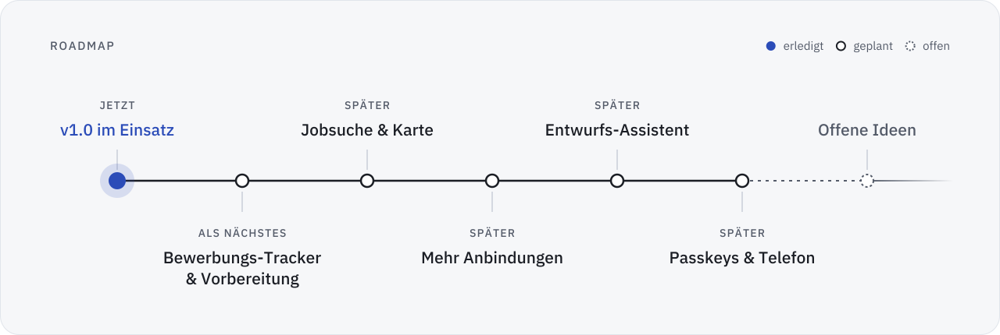

<picture>
  <source media="(prefers-color-scheme: dark)" srcset="assets/roadmap.de.dark.svg">
  
</picture>

[English](ROADMAP.md) · **Deutsch** · [Zurück zur Übersicht](README.de.md)

# Roadmap

Stand Release 46. Die Reihenfolge ist ein Plan, keine Zusage; je später ein Schritt, desto offener.

## Reihenfolge und Gründe

**Erst die eigene Nutzung.** Jeder Schritt nutzt die Daten des vorigen: Tracker und Bausteine speisen die Jobsuche, die Jobsuche den Assistenten, und der Assistent schreibt aus Bausteinen, die es schon gibt.

## Jetzt · v1.0 im Einsatz

Fertig seit Oktober 2026. Eine öffentliche Visitenkarte, ein massgeschneidertes Profil je Bewerbung hinter einem persönlichen Link mit PIN nach Wahl, ein Titelbild als Video oder Bild im Kopf eines Profils, mit einer Lage je Gerät und einem Editor, der den Bildschirm des Gastes zeigt, ein Download für alle Dokumente, eine Web-App für den Owner auf Deutsch und Englisch, AI Agents, die über MCP vorschlagen, und Abgleich mit GitHub und LinkedIn. Browser-Tests können parallel laufen, jeder Worker mit eigenem Testserver und eigener Datenbank. Siehe [Stand](README.de.md#stand).

## Als Nächstes

In Arbeit oder geplant in Version 1.x:

- AI Agents schlagen eine ganze neue Bewerbung vor, etwa aus einem Inserat, das als nicht vertrauenswürdig gilt. Änderungen an einer bestehenden Bewerbung können sie schon heute vorschlagen.
- AI Agents ziehen eigene Vorschläge zurück und sehen, welche noch offen sind.
- AI-Assistenten wie Claude und ChatGPT verbinden, indem man die Adresse des Servers einträgt und sich auf einer Zustimmungsseite anmeldet, die die Rechte auflistet. Claude Desktop und claude.ai verbinden sich schon heute mit einer OAuth-Anmeldung; persönliche Tokens bleiben als Rückweg.

### Bewerbungs-Tracker und Vorbereitung

- **Bewerbungs-Tracker**: jede Bewerbung von der ersten Idee bis zur Antwort, mit Status, Fristen, Kontakten, Notizen und Erinnerungen sowie einem Kalender-Feed (ICS).
- **Werkzeuge zur Vorbereitung** je Bewerbung, mit passenden Beispielen aus den Bausteinen.

## Später

### Jobsuche und Karte

- **Interaktive Suche mit Karte.** Arbeitswege erscheinen als erreichbare Flächen für ÖV, Velo und Auto.
- **Quellen**: offizielle Schnittstellen und Feeds, Karriereseiten der Arbeitgeber, wo deren Bedingungen es erlauben, und von Hand eingefügte Inserate. Kein Scraping von Jobportalen.

### Mehr Anbindungen

- **LinkedIn und GitHub mit einem Klick**, mit genau einer Richtung je Eintrag und einem Dreiwege-Vergleich, wenn sich beide Seiten geändert haben. In LinkedIn-Profile schreiben dürfen nur LinkedIn-Partner; Vorschläge für LinkedIn bleiben deshalb Texte zum Kopieren.
- **Weitere Quellen, wo sie Mehrwert bringen**: Zertifikate und Badges, Publikationen (ORCID), Kalender (Google, Microsoft) und Design-Portfolios.

### Entwurfs-Assistent

- **Vom Inserat zum ersten Entwurf**: eine vorgeschlagene Auswahl der Bausteine, Lebenslauf, Anschreiben und Dokumente, auf Deutsch und Englisch, die die Person prüft, bearbeitet und freigibt. In Version 1.0 schlagen AI Agents einzelne Bausteine und Texte vor.
- **Skill-Lücken**: was eine Zielstelle verlangt und das Profil noch nicht zeigt, mit konkreten Wegen, die Lücke zu schliessen oder zu belegen.
- **Die Freigabe durch den Menschen bleibt.** Nichts geht ohne das Ja der Person hinaus. Inserate und hochgeladene Dokumente gelten als nicht vertrauenswürdig.

### Passkeys und Telefon

- **Passkeys** für die Anmeldung und eine **installierbare Web-App** (PWA) fürs Telefon.

## Offene Ideen

- Mehr Sprachen: Französisch und Italienisch.
- Ein Datenschutz-Cockpit mit einem Schalter, der jeden Link widerruft.
- Ein zweites Paar Augen: Eine Vertrauensperson prüft eine Bewerbung, bevor sie hinausgeht.
- Eine Erklärung zur Barrierefreiheit je Profil.
