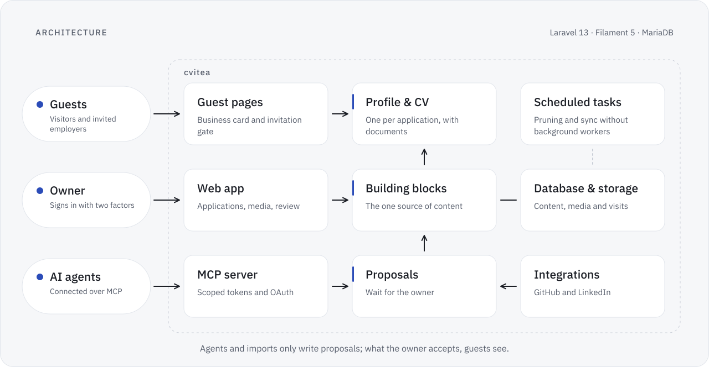

<picture>
  <source media="(prefers-color-scheme: dark)" srcset="../assets/architecture.en.dark.svg">
  
</picture>

**English** · [Deutsch](architecture.de.md) · [Back to the overview](../README.md)

# Architecture of cvitea

cvitea is one Laravel 13 application with Filament 5 for the owner's web app, on PHP 8.5 and MariaDB 10.11, on Swiss web hosting without background workers. It has three ways in, and each has its own protection: guests come through the invitation gate, the owner through a web app with two-factor sign-in, AI agents through an MCP server with scoped tokens. This page describes the parts, three paths through them, the main design decisions and how security is built in. It names mechanisms, not settings.

## The parts

| Part | What it does |
|---|---|
| Guest pages | The public business card, the invitation gate and the pages behind it, in German and English |
| Profile and CV | One profile per application, assembled from building blocks, with the documents and one download for all of them |
| Web app | The owner's workspace: applications, building blocks, proposals, translations, media and hero media, connections and the audit log |
| Building blocks | The one source of content: roles, projects, education, skills, documents and texts, each in German and English |
| MCP server | Lets AI agents read career data and hand in proposals, over OAuth or a personal token |
| Proposals | Every change from an agent or an import waits here until the owner accepts or declines it |
| Integrations | Import from GitHub and LinkedIn with a guided comparison; on the owner's click, changes go back to GitHub |
| Scheduled tasks | Delete old visits and messages, sync sources and tidy up files, started by the hosting's own scheduler |

## Three paths through the platform

### A guest opens an invitation

1. Opening the invitation page shows a form and changes nothing: guest pages run without a session, and merely opening a page never sets a cookie, so link scanners and mail previews leave no trace. A cookie comes only with a valid code.
2. The guest sends the code. The gate accepts the form only from its own site, limits attempts and looks the code up by its keyed hash. An unknown, expired or revoked link gets the same neutral page, so nobody learns which of the three it was.
3. If the invitation has a PIN, a second step asks for it, with its own limits.
4. Access is an encrypted cookie that only travels over HTTPS, is out of reach of scripts and ends with the invitation.
5. Every later request checks the invitation in the database again, so a revoked link stops at once.
6. The visit is recorded after the page has been sent, with coarse details and without the IP address; known bots are left out.

### An agent proposes a change

1. An agent connects over MCP, with OAuth or a personal token. Each tool checks the token's scopes; calls refused for their origin or scope are logged.
2. A writing tool creates a proposal and records which state of the content it is based on. Nothing visible changes, and the owner is notified.
3. The owner reviews the proposal in the web app and accepts or declines it.
4. Accepting writes the change in one database transaction. If the content has changed since the proposal was made, the proposal counts as stale and goes through only when the owner confirms it.
5. Guest pages read the building blocks directly, so an accepted change is visible without a separate publishing step. Imports from GitHub and LinkedIn take the same path.

### A release goes out

1. The deploy script runs `composer ci` first and stops when it is red.
2. A dry run shows what would change; only a second, explicit run applies it.
3. The new release replaces the old one in a single switch.
4. A health check and the security header check follow; the coordinating session then watches the platform for ten minutes.
5. The way back: the same script returns to the previous release. It does not undo database changes.

## Design decisions

| Decision | Why | What it costs |
|---|---|---|
| Shared web hosting without background workers | Little to operate and to secure, hosted in Switzerland | Follow-up work, such as recording a visit or notifying the owner, runs after the response; scheduled tasks are started by the hosting's scheduler instead of a worker |
| Building blocks as the one source of content | One edit reaches the profile, the CV, the translations and the documents | Every view is assembled from blocks, so their structure has to stay stable |
| Agents only propose | Agents can read and draft, while every change to what employers see stays a human decision | The owner reviews each proposal; stale proposals need a confirmation |
| Invitation codes only as keyed hashes at the gate | A copy of the database does not reveal working links | To show a link again, the platform keeps a separately encrypted copy of the code |
| One neutral answer for every closed link | Nobody learns whether a link exists, has expired or was revoked | A guest with an old link sees the same page as someone guessing |
| No session on guest pages | Fewer moving parts; opening a page leaves nothing behind | Forms on guest pages need their own protection, without a session to lean on |
| Strict content security policy on guest pages | No inline scripts or styles, so injected markup cannot run | Every script and style on guest pages is a file of its own |
| Visits without IP addresses | The owner sees interest in an application, not network data | Locations are approximate |
| No scraping of job portals | The portals' terms of use | Data comes from the person's own exports and from official APIs |

## Security by design

- **Owner sign-in** with mandatory two-factor authentication; only the owner reaches the web app.
- **Invitations**: random codes, matched by keyed hash, stored otherwise only encrypted, rate-limited and revocable at once; an optional PIN per link.
- **Guest access**: an encrypted cookie bound to the invitation, checked again on every request.
- **Headers on every response**: Content-Security-Policy, X-Frame-Options, X-Content-Type-Options, Referrer-Policy, Cross-Origin-Opener-Policy, Cross-Origin-Resource-Policy, Permissions-Policy and Strict-Transport-Security; pages behind a link also send X-Robots-Tag, so search engines leave them out.
- **AI agents**: scoped tokens, a scope check in every tool, limits per token, proposals or private uploads only, and no access to invitations, visits or guests' messages.
- **Uploads** are checked on arrival and stay private until the owner accepts a proposal that uses them.
- **Personal data** is stored only in the platform's database and storage; AI agents the owner connects read career data and documents within their scopes. Tests, screenshots and seeds use a fictional person, and a deny list and a secret scan guard every export and push.
- **Checks**: security tests in the Pest suite, the header check locally and in production, and the check path described in [How cvitea is built](how-its-built.md).
- **Reporting**: see [SECURITY.md](../SECURITY.md).
