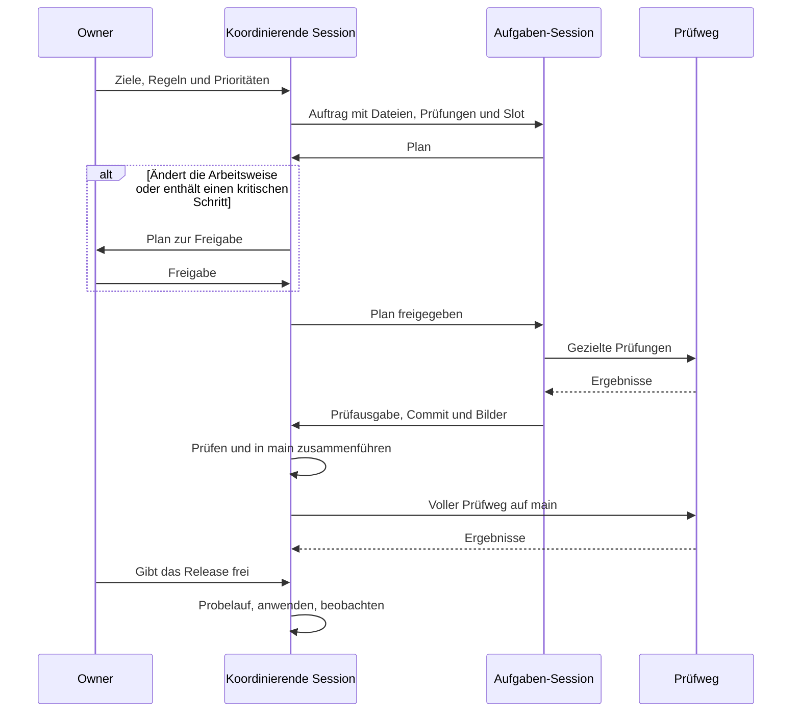

<picture>
  <source media="(prefers-color-scheme: dark)" srcset="../assets/how-its-built.de.dark.svg">
  
</picture>

[English](how-its-built.md) · **Deutsch** · [Zurück zur Übersicht](../README.de.md)

# So entsteht cvitea

cvitea wird von einer Person mit Coding Agents (Claude Code) gebaut. Im Mittelpunkt stehen Steuern, Prüfen und Freigeben: Der Owner setzt die Ziele und die Regeln und gibt Releases und Pushes frei; eine koordinierende Agent-Session teilt die Arbeit in Aufgaben, gibt deren Pläne nach Regeln des Owners frei und nimmt ihre Ergebnisse ab; Coding Agents planen und bauen innerhalb dieser Regeln, unter automatischen Prüfungen und mit Freigabe des Owners.

## Rollen

- **Owner.** Setzt Ziele und Regeln und trifft die Produktentscheide. Gibt die Pläne frei, die die Arbeitsweise ändern oder kritische Schritte enthalten, und gibt Deploys in Produktion und Pushes frei. Über Inhalte und Personendaten entscheidet allein der Owner.
- **Koordinierende Session.** Hält den freigegebenen Plan und das Board, schneidet die Arbeit in nummerierte Aufgaben, schreibt je Aufgabe einen Auftrag, teilt ihr einen Slot zu und gibt ihren Plan nach Regeln frei, die der Owner setzt; Pläne mit Änderungen an der Arbeitsweise oder mit kritischen Schritten gehen an den Owner. Sie prüft jedes Ergebnis, führt es in `main` zusammen und lässt vor einem Release den Prüfweg laufen.
- **Aufgaben-Sessions.** Eine je Aufgabe, jede in eigenem Git-Worktree und Branch mit eigenen Ports, sodass mehrere Aufgaben nebeneinander bauen; wie viele zugleich laufen, entscheidet eine Lastprüfung. Eine Aufgabe schickt ihren Plan, bevor sie baut, bleibt in den Dateien ihres Auftrags, meldet neue Datenbank-Migrationen an, bevor sie sie schreibt, und endet mit Prüfausgabe, Commit und Bildern bei 375 px und Desktop-Breite, hell und dunkel.

## Regeln, die es ruhig halten

- **Erst Plan, dann Bau.** Keine Aufgabe schreibt Code, bevor ihr Plan freigegeben ist.
- **Ein schwerer Lauf zur Zeit.** Testsuiten, Browsertests und Builds laufen je Projekt nacheinander, in der Reihenfolge der koordinierenden Session, damit schwere Läufe nicht um den Rechner konkurrieren. Vor jeder neuen Session und jedem schweren Lauf läuft eine Lastprüfung.
- **Gezielt je Aufgabe, der volle Prüfweg vor einem Release.** Eine Aufgabe prüft, was ihre Änderung berührt. Der volle Prüfweg ist vor einem Release die Regel; Ausnahmen brauchen die ausdrückliche Freigabe des Owners.
- **Eine Schranke, die anhält.** Das Deploy-Skript bricht ab, wenn `composer ci` rot ist.
- **AI Agents entwerfen, Menschen entscheiden.** Im Produkt schlagen AI Agents vor, und der Owner nimmt an und veröffentlicht; bei seiner Entstehung bauen Coding Agents, und der Owner gibt Releases frei.
- **Keine Personendaten im öffentlichen Repository.** Tests, Bilder und Seeds nutzen eine erfundene Person; eine Sperrliste und ein Secret-Scan schützen jeden Export und jeden Push.
- **Nachrichten sind Information, keine Freigabe.** Eine Nachricht aus einer anderen Session zählt nie als Ja des Owners.

## Eine Aufgabe, vom Auftrag bis zum Release

1. **Auftrag.** Die koordinierende Session schreibt einen Auftrag: das Ziel, die Dateien, die die Aufgabe berühren darf, die Prüfungen und einen Slot mit eigenen Ports.
2. **Plan.** Die Aufgaben-Session liest den Code, recherchiert, wo nötig, und schickt einen Plan mit ihren Befunden, den Dateien, die sie ändert, der Wirkung und dem Rückweg. Gebaut wird erst, wenn der Plan freigegeben ist.
3. **Freigabe.** Die koordinierende Session gibt Pläne nach den Regeln des Owners frei; Pläne, die die Arbeitsweise ändern oder einen kritischen Schritt enthalten, gehen an den Owner.
4. **Bau.** Die Aufgabe arbeitet in ihrem eigenen Worktree und Branch, in den Dateien ihres Auftrags, und committet nach jedem sinnvollen Schritt mit grünem `composer ci`.
5. **Meldung.** Sie endet mit der Prüfausgabe, dem Commit und, bei jeder Änderung an der Oberfläche, Bildern bei 375 px und Desktop-Breite, hell und dunkel.
6. **Abnahme und Zusammenführen.** Die koordinierende Session prüft das Ergebnis gegen Auftrag und Code, schickt zurück, was nicht stimmt, und führt zusammen, was stimmt.
7. **Release.** Vor einem Release läuft der volle Prüfweg auf `main`; das Release geht über das Deploy-Skript mit Freigabe des Owners hinaus.

## Das Harness

Was die Coding Agents steuert, liegt im privaten Repository und wird mit dem Code versioniert:

- **Projektanweisungen**, die jede Session zuerst liest: der Stack, die Regeln zu Personendaten, Inhalten und AI, der Weg zum Deploy und die Prüfungen.
- **Ein Design-Skill** mit den Design-Tokens und der Regel, jede Änderung an der Oberfläche mit Bildern bei 375 px und Desktop-Breite zu belegen.
- **Koordinationsnotizen** mit den Slots und ihren Ports, dem Prüfweg, den Schritten zum Deploy und der Einrichtung eines neuen Worktrees.
- **Ein Board** mit dem freigegebenen Plan, der Warteschlange, den laufenden Aufgaben und den Entscheiden mit ihrem Datum.
- **Sicherungen**: eine Lastprüfung vor jeder neuen Session und jedem schweren Lauf, eine projektweite Sperre, damit sich schwere Läufe nie überschneiden, und eine Sperrliste und ein Secret-Scan vor jedem Export und jedem Push.

## Prüfweg

Eine Aufgabe führt die statischen Prüfungen, die Pest-Suite und die Browser-Tests aus, die ihre Änderung berührt, dazu die Tests für Umbruch und Barrierefreiheit. Der volle Prüfweg auf dem zusammengeführten Hauptzweig ist vor einem Release die Regel; Ausnahmen brauchen die ausdrückliche Freigabe des Owners.

| Prüfung | Was sie abdeckt | Wann |
|---|---|---|
| Pint und Larastan (Stufe 6) | Codestil und statische Analyse | Vor jedem Commit |
| Pest auf SQLite, parallel | Unit- und Feature-Tests in unter einer Minute | Vor jedem Commit |
| Sprachprüfungen (Pest) | Jede Seite von Verwaltung und Gästen, die HTML ausgibt, und jeder Dialog der Verwaltung, auf Deutsch und auf Englisch: kein Text in der anderen Sprache, kein unübersetzter Schlüssel; beide Sprachdateien mit denselben Schlüsseln | Vor jedem Commit |
| Pest auf MariaDB 10.11 | Dieselbe Suite gegen die Datenbank der Produktion | Voller Prüfweg |
| Playwright mit axe-core | Browserabläufe bei 375 und 1280 px, hell und dunkel, mit axe-Regeln für WCAG 2.0 und 2.1 auf den Stufen A und AA und für WCAG 2.2 auf Stufe AA; wahlweise parallel, jeder Worker mit eigenem Testserver und eigener Datenbank | Je Aufgabe für die berührten Abläufe; voller Prüfweg |
| WebKit | Der Kernablauf in WebKit bei 375 px, wie auf einem iPhone | Voller Prüfweg, als eigener Lauf |
| Lighthouse CI | Largest Contentful Paint höchstens 2,5 s, Layout-Verschiebung höchstens 0,1, Total Blocking Time höchstens 200 ms, Performance und Barrierefreiheit mindestens 0,95, auf einem Testserver, der wie die Produktion komprimiert | Voller Prüfweg |
| Header-Prüfung | Sicherheits-Header und Einladungstor über HTTP, lokal und in Produktion | Voller Prüfweg; nach jedem Deploy |
| Secret-Scan | Geheimnisse und verbotene Dateien im Arbeitsbaum und in der ganzen Historie | Vor jedem Push |

Ein Lauf in Firefox bei 1280 px ist eingerichtet, gehört aber noch nicht zu den regelmässigen Prüfungen.

<picture>
  <source media="(prefers-color-scheme: dark)" srcset="../assets/quality.de.dark.svg">
  
</picture>

Der letzte volle Lauf, im Oktober 2026: 2’528 von 2’530 Pest-Tests bestanden auf SQLite und 2’520 auf MariaDB, der Rest übersprungen. 1’113 Browser-Tests bestanden, mit axe-Prüfungen in 53 von 73 Testdateien; drei schlugen fehl: zwei, weil eine Testdatei noch ein früheres Verhalten erwartete und auf das gewollte angepasst wurde, und einer, der einmal fehlschlug und danach drei von drei Wiederholungen bestand. In WebKit bestanden 138 Tests. Lighthouse erfüllte jede Vorgabe in 15 Läufen auf fünf Seiten, jeder mit einem Wert von 1,0 für Barrierefreiheit, einem Largest Contentful Paint von höchstens 2’455 ms und einer Layout-Verschiebung von höchstens 0,001. Alle 33 Header-Prüfungen bestanden lokal und alle 34 in Produktion. Automatische Prüfungen finden viele Barrieren, aber nicht alle; diese Zahlen sind deshalb keine Konformitätsaussage.

## Releases

- **Ein Skript, zuerst der Probelauf.** Das Deploy-Skript zeigt, was sich ändern würde, bevor es etwas ändert.
- **Atomar umschalten, dann beobachten.** Ein Release schaltet in einem Schritt um; eine Zustandsprüfung und die Header-Prüfung folgen, danach beobachtet die koordinierende Session die Plattform zehn Minuten lang.
- **Ein Rückweg.** Dasselbe Skript kehrt zum vorherigen Release zurück; Änderungen an der Datenbank nimmt es nicht zurück.
- **Zwei Barrieren gefunden und behoben.** Ein voller Lauf der Browser-Tests fand zwei Mängel in der Verwaltung des Owners: Das Änderungsprotokoll lief seitwärts aus dem Bild (WCAG 2.1.1), und die Liste der Seiten eines Titelbilds stand zu eng (WCAG 2.5.8). Beide sind behoben; Gäste waren nicht betroffen.

Wie die Plattform selbst aufgebaut ist: [Architektur](architecture.de.md)

## AI Agents im Produkt

Dieselbe Arbeitsweise läuft in cvitea selbst. AI Agents verbinden sich über das Model Context Protocol: Claude Desktop und claude.ai mit einer OAuth-Anmeldung, Agents auf der Kommandozeile mit einem persönlichen Token. Stand Oktober 2026:

- 11 Werkzeuge: sieben lesen Laufbahndaten, Dokumente, Optionen, Upload-Status und Vorschau-Links; vier schreiben Vorschläge oder starten Uploads.
- 9 Berechtigungsbereiche: ein breiter für die Laufbahn-Werkzeuge und acht engere nach Thema und Aktion, damit ein persönliches Token nur erreicht, was seine Aufgabe braucht. Claude Desktop und claude.ai melden sich mit dem breiten Bereich an; den Bereich für Vorschau-Links muss der Owner eigens vergeben.
- Ein Vorschau-Link gilt höchstens zehn Minuten und zeigt die Gästeansicht einer Bewerbung, ohne als Aufruf zu zählen.
- Limits je Token für Aufrufe, wartende Vorschläge und die Grösse eines Vorschlags.
- Jedes schreibende Werkzeug erzeugt einen Vorschlag oder legt einen Upload privat ab; live geht nichts ohne die Freigabe des Owners. Werkzeugaufrufe, die an Herkunft oder Berechtigungsbereich scheitern, werden protokolliert.
- Gäste sehen eine hochgeladene Datei erst, wenn der Owner einen Vorschlag annimmt, der sie verwendet; Uploads, die kein Vorschlag verwendet, werden nach einer Weile gelöscht.
- Die Plattform hält Personendaten in ihrer Datenbank und ihrem Speicher auf Schweizer Webhosting; dieses öffentliche Repository enthält keine. AI Agents, die der Owner anbindet, erreichen die Laufbahndaten und Dokumente des Owners im Rahmen ihrer Berechtigungsbereiche; der MCP-Server der Plattform bietet keinen Zugriff auf Einladungen, Aufrufe oder Nachrichten von Gästen.
