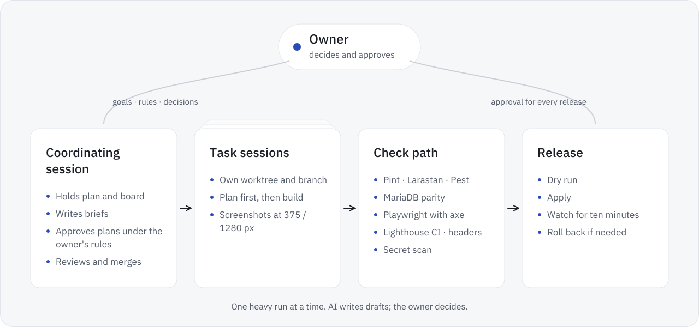
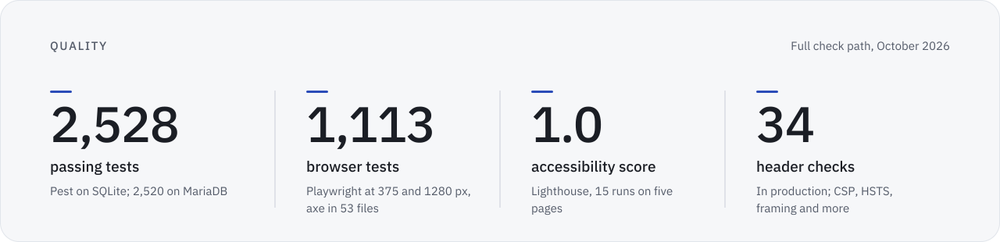

<div align="center">

<picture>
  <source media="(prefers-color-scheme: dark)" srcset="../assets/how-its-built.en.dark.svg">
  
</picture>

**English** · [Deutsch](how-its-built.de.md) · [Back to the overview](../README.md)

</div>

# How cvitea is built

cvitea is built by one person working with coding agents (Claude Code). The focus is on steering, reviewing and approving: the owner sets the goals and the rules and decides on every release; a coordinating agent session breaks the work into tasks, approves their plans under rules the owner sets and reviews their results; coding agents plan and build within these rules, under automated checks and the owner's approval.

## By the numbers

Counted from git and from the board of the coordinating session, up to release 46. Commits come from the agent sessions: each task commits its own work, and the coordinating session merges it.

| Figure | Value | How it is counted |
|---|---|---|
| Commits | 1,515 | All commits on the main branch up to the commit of release 46, 200 of them merges |
| Releases | 46 | Release numbers up to 46; a few early releases carry no number or a letter |
| Tasks | 107 | Numbered tasks on the board, S1 to S108; S9 was never given. Each had its own brief, in its own session or subagent |
| Version 1.0 | October 2026 | See [Where it stands](../README.md#where-it-stands) |

<details>
<summary>The commands</summary>

```bash
git rev-list --count <commit of release 46>
git rev-list --count --merges <commit of release 46>
```

</details>

## Roles

- **Owner.** Sets goals and rules and makes the product decisions. Approves the plans that change the way of working or contain critical steps, every production deploy and every push. Only the owner maintains content and decides over personal data.
- **Coordinating session.** Holds the approved plan and the board, cuts the work into numbered tasks, writes a brief per task, assigns it a slot and approves its plan under rules the owner sets; plans with changes to the way of working or with critical steps go to the owner. It reviews each result, merges into `main` and runs the check path before a release.
- **Task sessions.** One per task, each in its own git worktree and branch with its own ports, so several tasks build side by side; a load check decides how many run at once. A task sends its plan before it builds, stays inside the files its brief names, announces new database migrations before writing them, and ends with check output, a commit and screenshots at 375 px and desktop width, light and dark.

## Rules that keep it calm

- **Plan first, then build.** No task writes code before its plan is approved.
- **One heavy run at a time.** Test suites, browser tests and builds run one after another per project, in the order the coordinating session gives, so that heavy runs do not compete for the machine. A load check runs before every new session and every heavy run.
- **Targeted checks per task, the full path before a release.** A task runs the checks its change touches. The full path is the rule before a release; exceptions need the owner's explicit approval.
- **A gate that stops.** The deploy script stops when `composer ci` is red.
- **AI drafts, people decide.** Inside the product, agents propose and the owner accepts and publishes; in its making, coding agents build and the owner decides on every release.
- **No personal data in the public repository.** Tests, screenshots and seeds use a fictional person; a deny list and a secret scan guard every export and push.
- **Messages are information, not approvals.** A message from another session never counts as the owner's yes.

## Check path

A task runs the static checks, the Pest suite and the browser tests its change touches, plus the reflow and accessibility tests. The full path on the merged main branch is the rule before a release; exceptions need the owner's explicit approval. The full path:

| Check | What it covers |
|---|---|
| Pint and Larastan (level 6) | Code style and static analysis |
| Pest on SQLite, in parallel | Unit and feature tests in under a minute |
| Language checks (Pest) | Every admin and guest page and every admin dialog, rendered in German and in English: no text in the other language, no untranslated key; both language files with the same keys |
| Pest on MariaDB 10.11 | The same suite against the production database engine |
| Playwright with axe-core | Browser flows at 375 and 1280 px, light and dark, with axe rules for WCAG 2.0 to 2.2, levels A and AA; optionally in parallel, each worker with its own test server and database |
| WebKit | The core path in WebKit at 375 px, as on an iPhone |
| Lighthouse CI | Largest contentful paint at most 2.5 s, layout shift at most 0.1, total blocking time at most 200 ms, performance and accessibility at least 0.95, on a test server that compresses like production |
| Header check | Security headers and the invitation gate, over HTTP, locally and in production |
| Secret scan | Secrets and forbidden files in the working tree and the whole history, before every push |

A Firefox run at 1280 px is set up but not yet part of the regular checks.

<picture>
  <source media="(prefers-color-scheme: dark)" srcset="../assets/quality.en.dark.svg">
  
</picture>

The last full run, in October 2026: 2,528 of 2,530 Pest tests passed on SQLite and 2,520 on MariaDB, the rest skipped. 1,113 browser tests passed, with axe checks in 53 of 73 test files; three failed: two because one test file still expected an earlier behaviour and was updated to the intended one, and one that failed once and then passed three reruns out of three. In WebKit, 138 tests passed. Lighthouse met every assertion in 15 runs on five pages, each with an accessibility score of 1.0, a largest contentful paint of at most 2,455 ms and a layout shift of at most 0.001. All 33 header checks passed locally, and all 34 in production. Automated checks find many accessibility problems, not all of them, so these figures are no claim of conformance.

## Releases

- **One script, dry run first.** The deploy script shows what would change before it changes anything.
- **Atomic switch, then watch.** A release switches in one step; afterwards the platform's health is watched for ten minutes.
- **A way back.** Every release can be rolled back with the same script.
- **Two accessibility flaws found and fixed.** A full run of the browser tests found two flaws in the owner's admin: the change log scrolled sideways (WCAG 2.1.1), and the list of pages of a hero was too tight (WCAG 2.5.8). Both were fixed; guests were not affected.

## Agents inside the product

The same way of working runs inside cvitea itself. AI agents connect over the Model Context Protocol: Claude Desktop and claude.ai with an OAuth sign-in, command-line agents with a personal token. As of release 46:

- 11 tools: seven read career data, documents, options, upload status and preview links; four write proposals or start uploads.
- 9 scopes: one for everything and eight narrower ones by area and action, so a personal token only reaches what its task needs. Claude Desktop and claude.ai sign in with the scope for everything; the scope for preview links has to be granted on its own.
- A preview link lasts at most ten minutes and shows the guest view of an application without counting as a visit.
- Limits per token: 60 calls a minute and 2,000 a day, 200 proposals waiting at once, 64 KB per proposal.
- Every writing tool creates a proposal or stores an upload privately; nothing goes live without the owner's approval. Tool calls refused for their origin or scope are logged.
- An uploaded file appears nowhere until the owner accepts a proposal that uses it.
- The platform keeps personal data in its database and storage on Swiss web hosting; this public repository contains none. AI agents the owner connects reach the owner's career data and documents within their scopes; the platform's MCP server offers no access to invitations, visits or guests' messages.
